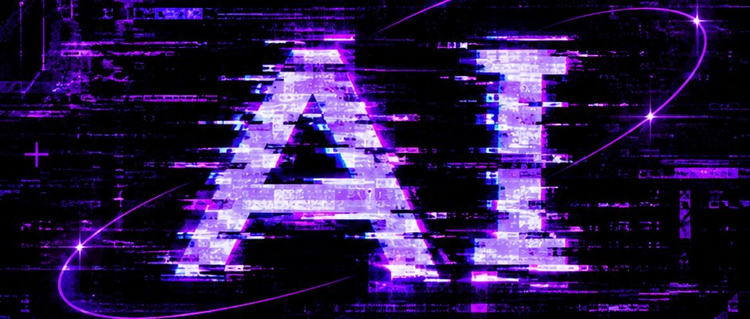

# Hi, I'm Reham Fawzy

### AI Engineer | Machine Learning & Deep Learning

**Artificial Intelligence Graduate – Cairo University**

Building intelligent solutions through data, algorithms, and deep learning.

---

## About Me

I'm an Artificial Intelligence graduate from **Cairo University, Faculty of Computers and Artificial Intelligence**.

I have a solid foundation in Machine Learning, Deep Learning, Data Science, Computer Vision, and Natural Language Processing.

My practical experience includes:

- Developing Machine Learning models for classification and regression.
- Data preprocessing, exploratory data analysis, and feature engineering.
- Training and evaluating Deep Learning models.
- Building Computer Vision applications using CNNs and YOLO.
- Working with NLP techniques, including Word2Vec and Transformers.
- Developing interactive ML applications using Streamlit.

I'm passionate about solving real-world problems and continuously expanding my knowledge in Artificial Intelligence.

---

<h2 align="center">⚡ Technical Skills & Technologies</h2>

  Technologies and tools I use to build Machine Learning and AI solutions.

### 01. Programming & Data Science

  
  
  
  
  

### 02. Machine Learning

  
  

- Supervised & Unsupervised Learning
- Classification, Regression & Clustering
- Feature Engineering & Feature Selection
- Model Evaluation & Cross-Validation
- Hyperparameter Tuning
- Handling Imbalanced Datasets

### 03. Deep Learning

  
  
  

- Artificial Neural Networks (ANN)
- Convolutional Neural Networks (CNN)
- Recurrent Neural Networks (RNN)
- Long Short-Term Memory (LSTM)
- Transfer Learning

### 04. Computer Vision

  
  

- Image Classification
- Image Segmentation
- Object Detection
- U-Net Architecture

### 05. Natural Language Processing (NLP)

  
  
  

- Text Preprocessing & Tokenization
- Text Representation & Word Embeddings
- Word2Vec
- Recurrent Neural Networks
- Transformer Models

### 06. Tools & Development

  
  
  
  
  

---

<h2 align="center">🚀 Featured Projects</h2>

  Selected Machine Learning, Deep Learning, Computer Vision, and NLP projects.

### 01 | Home Credit Default Risk Prediction

`Machine Learning` `XGBoost` `Classification`

- Developed a Machine Learning pipeline to predict credit default risk.
- Performed data preprocessing and feature engineering.
- Applied SMOTETomek to handle class imbalance.
- Trained and evaluated an XGBoost classifier.

**Key Result: ROC-AUC = 0.8848**

---

### 02 | California House Price Prediction

`Machine Learning` `Regression` `Streamlit`

- Developed a regression model to predict California housing prices.
- Performed Exploratory Data Analysis (EDA) and preprocessing.
- Trained and evaluated the predictive model.
- Built an interactive application using Streamlit.

---

### 03 | MNIST Handwritten Digit Classification

`Deep Learning` `TensorFlow` `Keras`

- Developed a neural network for handwritten digit recognition.
- Implemented model training and evaluation workflows.
- Achieved **99.6% classification accuracy**.

---

### 04 | Breast Ultrasound Image Segmentation

`Deep Learning` `Computer Vision` `U-Net`

- Developed a U-Net model using the BUSI dataset.
- Implemented image preprocessing and segmentation.
- Evaluated performance using the Dice Score.

**Key Result: Dice Score = 0.924**

---

### 05 | Traffic Detection System

`Computer Vision` `YOLOv8` `Object Detection`

- Trained a YOLOv8m object detection model.
- Prepared and processed the dataset for training.
- Evaluated detection performance using mAP@50.

**Key Result: mAP@50 = 0.822**

---

### 06 | IMDB Sentiment Analysis

`NLP` `Word2Vec` `SimpleRNN`

- Applied text preprocessing and tokenization.
- Explored Word2Vec word embeddings.
- Developed a SimpleRNN-based sentiment classification model.

---

<h2 align="center">📚 Currently Learning</h2>

  
  
  

- Generative AI Fundamentals
- Large Language Models (LLMs)
- Retrieval-Augmented Generation (RAG)
- Modern AI Engineering Concepts

---
---

## Featured Projects

### 01. Home Credit Default Risk Prediction

**Machine Learning | XGBoost | Classification**

- Developed a machine learning pipeline for credit default risk prediction.
- Applied data preprocessing and feature engineering.
- Used SMOTETomek to handle class imbalance.
- Trained and evaluated an XGBoost classifier.

**ROC-AUC: 0.8848**

---

### 02. California House Price Prediction

**Machine Learning | Regression | Streamlit**

- Developed a regression model to predict California housing prices.
- Performed exploratory data analysis and data preprocessing.
- Trained and evaluated a predictive model.
- Built an interactive application using Streamlit.

---

### 03. MNIST Digit Classification

**Deep Learning | TensorFlow | Keras**

- Developed a neural network for handwritten digit classification.
- Implemented model training and evaluation.
- Achieved 99.6% classification accuracy.

---

### 04. Breast Ultrasound Image Segmentation

**Deep Learning | Computer Vision | U-Net**

- Developed a U-Net model using the BUSI dataset.
- Implemented image preprocessing and segmentation.
- Evaluated model performance using the Dice score.

**Dice Score: 0.924**

---

### 05. Traffic Detection System

**Computer Vision | YOLOv8**

- Trained a YOLOv8m object detection model.
- Prepared and processed the dataset.
- Evaluated object detection performance.

**mAP@50: 0.822**

---

### 06. IMDB Sentiment Analysis

**NLP | Word2Vec | SimpleRNN**

- Applied text preprocessing and tokenization.
- Explored Word2Vec word embeddings.
- Developed a SimpleRNN-based sentiment classification model.

---

## Currently Learning

- Generative AI
- Large Language Models (LLMs)
- Retrieval-Augmented Generation (RAG)
- Advanced AI Engineering Concepts

---

## GitHub Statistics

---

## Connect With Me

[LinkedIn](https://www.linkedin.com/in/reham-fawzy-314a30335/) ·
[Kaggle](https://www.kaggle.com/rehamfaw) ·
[GitHub](https://github.com/REHAMFAWZE)

**Email:** remonaaa734@gmail.com

### Build. Learn. Innovate.

